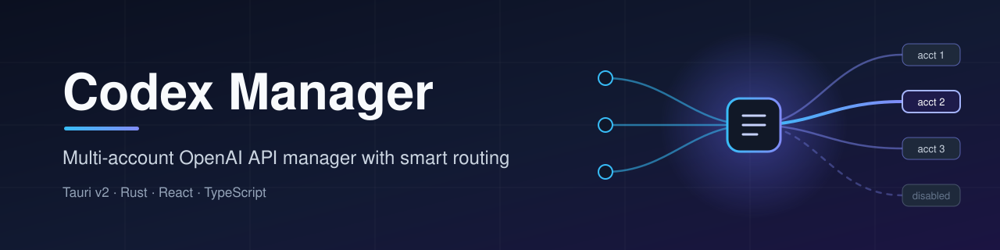
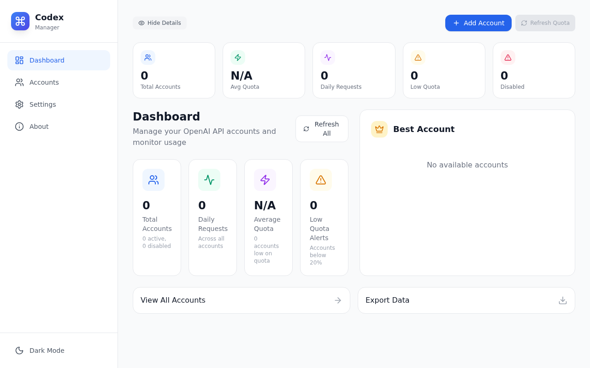
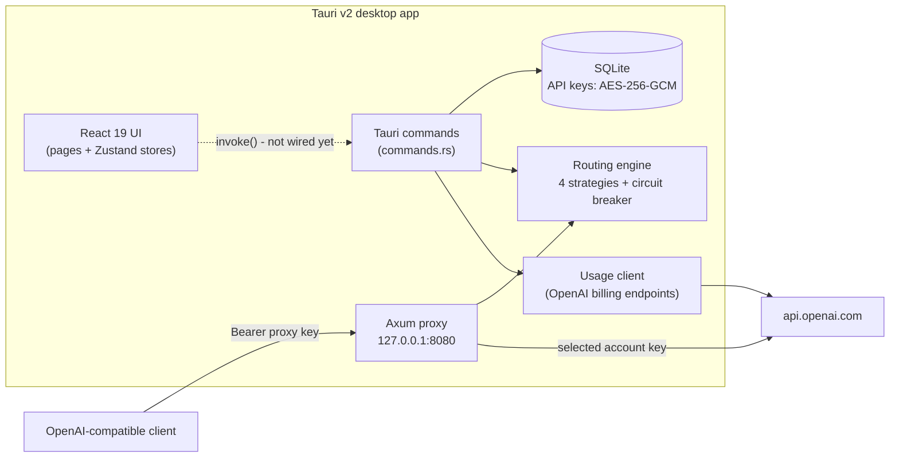

<div align="center">



**Multi-account OpenAI API manager with smart routing**

[](https://github.com/muhib-karim/codex-manager/actions/workflows/ci.yml)
[](LICENSE)

</div>

---

## What it is

Codex Manager is a desktop app (Tauri v2 + Rust + React/TypeScript) for people who juggle several
OpenAI API keys. The design:

- keep accounts (label, API key, org ID, model scope, daily/monthly limits, priority) in a local
  SQLite database with the API keys encrypted,
- read each account's usage from OpenAI's billing endpoints,
- run a local OpenAI-compatible proxy (`http://127.0.0.1:8080/v1`) that picks an account for every
  request using one of four routing strategies.

Clients see one endpoint and one key; the app spreads requests across accounts by usage, limits and
priority, and skips accounts that are disabled, over their limit or failing.



*The React UI running in the browser build. It is not wired to the Rust backend yet (see below).*

## Project status

**Work-in-progress prototype. Not ready for real API keys or daily use.**

| Part | State |
|---|---|
| React UI (`src/`) | Works in the browser and is linted, type-checked, unit-tested and built in CI. |
| Rust backend (`src-tauri/`) | **Work in progress.** Checked, linted (clippy) and unit-tested by the `rust` CI job; the CI badge above shows the current result. It is not compiled on developer machines as part of this project's workflow, and no packaged build has been run end to end. |
| UI to backend wiring | **Not done.** The UI never calls the backend: accounts live in memory (lost on reload) and settings in `localStorage`. From the UI there is no encrypted storage, no usage refresh and no proxy start/stop yet. |
| Releases | No release has been built. `release.yml` is ready but untested. |

See [Known limitations and roadmap](#known-limitations-and-roadmap) for what is deferred.

## Quick start

Requirements: Node.js 20 or newer (CI runs 20 and 22).

```bash
git clone https://github.com/muhib-karim/codex-manager.git
cd codex-manager
npm ci
npm run dev          # UI in the browser at http://localhost:1420
```

The desktop app additionally needs a stable Rust toolchain and the
[Tauri v2 system dependencies](https://tauri.app/start/prerequisites/):

```bash
npm run tauri dev    # desktop app in development mode
```

Details per platform: [docs/BUILD.md](docs/BUILD.md).

## Commands

| Command | What it does |
|---|---|
| `npm run dev` | Vite dev server for the React UI |
| `npm run lint` | ESLint over `src/`, `tests/` and the config files (warnings fail) |
| `npm run typecheck` | `tsc --noEmit` |
| `npm test` | Vitest unit tests (`tests/`) |
| `npm run build` | Type-check and production build into `dist/` |
| `npm run tauri dev` / `npm run tauri build` | Desktop app (needs Rust and the Tauri system dependencies) |
| `cargo test --locked` (in `src-tauri/`) | Rust unit tests; needs `dist/` to exist (`npm run build`) |

## Architecture



Backend modules (`src-tauri/src/`):

| File | Responsibility |
|---|---|
| `lib.rs` | App setup: plugins, storage, routing engine, tray, window, command registration |
| `commands.rs` | The 24 Tauri commands (accounts, usage, routing, proxy, import/export, config) |
| `models.rs` | Shared types; masking and redaction of API keys |
| `storage.rs` | SQLite store; API keys encrypted with AES-256-GCM |
| `routing.rs` | Routing strategies, model-scope filter, circuit breaker |
| `proxy.rs` | Axum proxy that forwards requests with the selected account's credentials |
| `usage.rs` | Billing usage and subscription queries, key validation |
| `config.rs` | `config.json`, data directory, master key |
| `tray.rs` | System tray icon (the window hides on close) |

The TypeScript side of the command contract is `src/lib/backend.ts`; a test
(`tests/backendContract.test.ts`) fails if its command list or the routing strategy names drift
from the Rust sources.

### Routing strategies

| Strategy | Behaviour |
|---|---|
| `least_utilized` (default) | Lowest utilization wins. Utilization is the tightest of: month-to-date spend against OpenAI's hard limit, against the account's monthly limit, and today's spend against the daily limit. Ties rotate. |
| `round_robin` | Cycles through the eligible accounts. |
| `priority` | Highest `priority` wins; ties rotate. |
| `sticky` | Requests whose first chat message is identical stay on one account; other requests fall back to `least_utilized`. |

An account is eligible when it is enabled, within its limits, allowed for the requested model and
its circuit breaker is not open. Three consecutive account-level failures (HTTP 401, 403, 429, 5xx
or a connection error) open the breaker for 60 seconds, after which the account is tried again.
There is no retry on another account within a single request yet.

### Proxy

- `GET /health` and `/healthz`: no key needed; returns `status`, `version`, `uptime_seconds`.
- Everything else needs `Authorization: Bearer <proxy key>` and is forwarded to the upstream API
  unchanged (method, path, query string, body, content type) with the selected account's key and
  organization. The upstream status, body (streamed, so SSE works) and a short list of response
  headers come back as they are.
- Binds to `127.0.0.1:8080` by default. No CORS headers are sent, so web pages cannot use it.
- Request bodies are limited to 64 MiB.

```bash
export OPENAI_BASE_URL="http://127.0.0.1:8080/v1"
export OPENAI_API_KEY="sk-codex-manager"   # the proxy's own key, not an OpenAI key
```

`sk-codex-manager` is only the default. Any local program that knows the proxy key can spend your
accounts, so change it before using real keys.

## Security model

- **API keys at rest:** encrypted with AES-256-GCM (random 96-bit nonce per value). The key is
  derived with Argon2id from a master key and a random salt stored in the database.
- **Master key:** the `CODEX_MANAGER_MASTER_KEY` environment variable if set; otherwise a random
  256-bit key generated on first run and stored in `master.key` in the app data directory
  (permissions 0600 on Unix). This protects a copied or synced `accounts.db`; it does not protect
  against someone who can read your user profile. OS keychain storage is not implemented.
- **Keys in the UI:** list and detail commands return accounts with the key masked. Only
  `export_accounts` returns keys, and exported files contain them in plain text.
- **Current UI limitation:** until the UI is wired to the backend, keys typed into the UI are held
  in browser memory and the proxy key from Settings is saved to `localStorage` unencrypted.
- **Data directory** (Tauri identifier `com.aidev2024.codex-manager`): `accounts.db`,
  `config.json`, `master.key`.

## Testing and CI

```bash
npm ci
npm run lint
npm run typecheck
npm test             # 65 tests: quota math, list/pagination, import, settings/theme, store, contract
npm run build
```

[`ci.yml`](.github/workflows/ci.yml) runs on pushes to `main` and on pull requests into `main`:

| Job | Steps |
|---|---|
| `frontend` (Node 20 and 22) | lint, type-check, tests, build, `npm audit --omit=dev --audit-level=high` |
| `rust` | Tauri system packages, frontend build, `cargo check`, `cargo clippy -D warnings -A dead_code`, `cargo test` (all `--locked`) |
| `gitleaks` | Secret scan of the full history |

`dead_code` is allowed in clippy only because the UI does not call the backend yet; the flag is to
be removed when it does. Rust unit tests cover storage and encryption, the four strategies and the
circuit breaker, the proxy (against a mock upstream on localhost), usage math and the command helpers.

## Known limitations and roadmap

Not implemented or deferred:

- **UI is not connected to the backend** (accounts in memory, settings in `localStorage`).
- **No packaged build has been run.** The window, tray, autostart and single-instance behaviour
  are untested.
- **No background usage polling.** Usage is fetched only on request. The billing endpoints used
  (`/v1/dashboard/billing/usage` and `/subscription`) are not part of OpenAI's documented API and
  may refuse standard API keys; token counts are not collected.
- **No failover within a request.** A failed request is returned to the client; later requests
  avoid the failing account.
- **No OS keychain**, no master-key change or re-encryption, no encrypted export.
- **Settings without effect:** language, notifications, rate limiting, auto-switch, compact mode
  and the proxy toggle are saved but nothing reads them yet.
- **Content Security Policy** still allows `unsafe-inline` and `unsafe-eval` for scripts, and
  `index.html` loads a font from Google Fonts.
- **Unused dependencies** (i18next, recharts, framer-motion, dnd-kit, radix and several crates)
  have not been pruned.
- `docs/ARCHITECTURE.md` and `docs/OPENCODE_INTEGRATION.md` still describe an earlier CLI design
  and are marked as outdated.

Known dependency advisories that are not patched:

| Crate | Why it is still there |
|---|---|
| `tauri` 2.10.1 (GHSA-7gmj-67g7-phm9, moderate) | Fixed in 2.11.1, which changes about 40 packages and adds a system library. To be bumped together with `@tauri-apps/api` and `@tauri-apps/cli` as its own change. The app only loads local content. |
| `libsqlite3-sys` 0.30.1 | Needs a `rusqlite` major upgrade. |
| `glib` 0.18.5 | Pinned by Tauri's GTK 3 stack on Linux. |
| `quick-xml` 0.38.4, `rand` 0.7.3 | Transitive, no compatible fixed version. |
| 13 "unmaintained" notices | Transitive crates (`unic-*`, `paste`, `fxhash`, `zvariant`, and others). |

`npm audit` reports no vulnerabilities.

## Project structure

```
codex-manager/
├── src/                    React + TypeScript UI
│   ├── pages/, components/ Dashboard, Accounts, Settings, About
│   ├── stores/             Zustand stores (accounts in memory, config in localStorage)
│   ├── utils/              Pure helpers: quota, account list, import, settings, format
│   └── lib/backend.ts      Typed contract for the Tauri commands
├── src-tauri/              Tauri v2 Rust backend (see the module table above)
├── tests/                  Vitest unit tests
├── docs/                   Build notes, API notes, banner
├── .github/workflows/      ci.yml and release.yml
└── package.json
```

## Contributing

Issues and pull requests are welcome. Before opening a pull request run `npm run lint`,
`npm run typecheck` and `npm test`; the Rust checks run in CI. Keep each pull request focused and
say how you tested it.

## License

[MIT](LICENSE) © 2026 Muhib Al Karim

If you find this useful, you can support it on [Ko-fi](https://ko-fi.com/ai_dev_2024).
